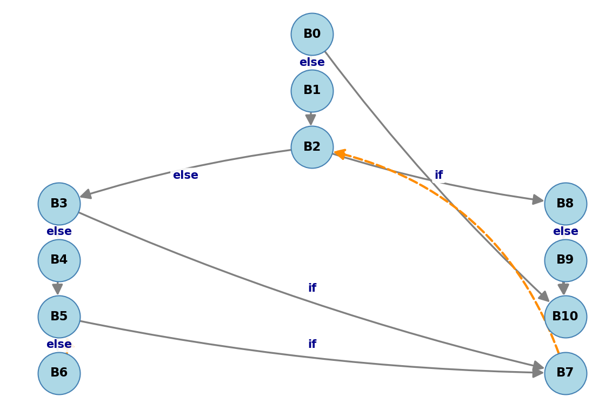
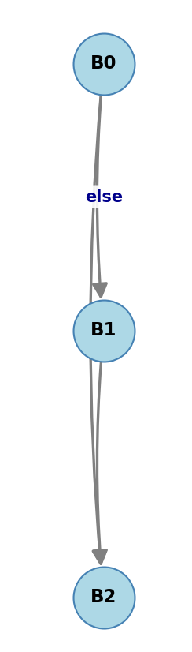
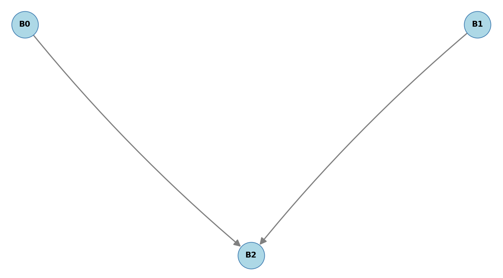

# Анализатор REIL-программ

Учебный проект на Python для построения графов потока управления (CFG, Control Flow Graph) по текстовым программам на REIL, обхода графов и проверки двух CFG на изоморфизм.

## Возможности

- Чтение REIL-подобных программ из файлов.
- Разбор инструкций, операндов, комментариев и меток.
- Выделение базовых блоков и построение ориентированного CFG.
- Вывод списка смежности графа в консоль.
- Обход графа в глубину и поиск недостижимых базовых блоков.
- Визуализация графа с помощью Matplotlib.
- Сравнение CFG двух программ на изоморфизм с выводом соответствия вершин, если оно найдено.

## Требования и установка

- Python 3.12 или новее.
- Библиотеки `networkx` и `matplotlib` для визуализации.

Установите зависимости:

```
python -m pip install networkx matplotlib
```

Остальные используемые модули входят в стандартную библиотеку Python.

## Запуск
##### В файле `main.py` укажите программы для анализа:

   ```
   FILE1 = 'examples/file1.rail'
   FILE2 = 'examples/not_isomorphic.rail'
   ```
##### Запустите `main.py`
   
Для анализа только одной программы задайте пустую строку для второй:

```
FILE1 = 'examples/totient.reil'
FILE2 = ''
```

### Что выводится

Для каждого файла программа:

1. Читает и разбирает исходный текст.
2. Строит граф потока управления.
3. Печатает рёбра графа потока управления в консоль.
4. Выводит порядок обхода алгоритма поиска в глубину и список недостижимых блоков.
5. Открывает окно с визуализацией CFG.

Если указаны два файла, после построения обоих CFG выполняется их сравнение на изоморфизм.

Пример вывода для настроек по умолчанию:

```
Первый REIL-файл: examples/file1.rail
Второй REIL-файл: examples/not_isomorphic.rail
========== CFG 1 ==========
Граф потока управления:
B0 -> ['B2', 'B1']
B1 -> ['B2']
B2 -> []
DFS: [0, 2, 1]
Недостижимые: []
========== CFG 2 ==========
Граф потока управления:
B0 -> ['B2']
B1 -> ['B2']
B2 -> []
DFS: [0, 2]
Недостижимые: [1]
Графы не изоморфны
```

Окна Matplotlib показываются последовательно: в обычном режиме `plt.show()` ожидает закрытия текущего окна перед продолжением программы.

   ##### Графы потока управления для totient.rail
  

   ##### Графы потока управления для неизоморфных графов
  
   
  
  
## Поддерживаемый формат программы

Программа состоит из меток, инструкций и комментариев:

- Комментарии начинаются с `;`.
- Метки заканчиваются символом `:` и могут находиться на отдельной строке или перед инструкцией.
- Инструкция содержит название операции и три операнда, разделённых запятыми. Пустые операнды допустимы, например `NOP , ,`.
- Для построения переходов используются метки из третьего операнда.
- В `cfg.py` распознаются условные переходы `JG`, `JGE`, `JL`, `JLE`, `JE`, `JNE` и операция `JCC`

### Правила построения CFG

Вершины графа - базовые блоки, то есть последовательности инструкций без внутренних переходов управления. Начала блоков определяются по первой инструкции, меткам, целям переходов и инструкциям непосредственно после переходов.

Рёбра графа задаются последней инструкцией блока:

- Условный переход (`JG`, `JLE` и др.) создаёт ребро к метке и, если есть следующая инструкция, ребро к следующему блоку.
- `JCC`: при первом операнде `1` учитывается переход к метке; при `0` - только продолжение выполнения; при другом значении - оба возможных пути.
- Обычная инструкция создаёт переход к следующему блоку, если он существует.

При построении CFG включаются все базовые блоки, даже недостижимые из начальной вершины.

## Обход графа и поиск недостижимых блоков

В `traversal.py` реализован поиск в глубину с использованием стека. Обход начинается с вершины `cfg.entry` и возвращает порядок посещения достижимых блоков.

## Проверка изоморфизма

`isomorphism.py` сравнивает два ориентированных CFG с помощью класса алгоритмов перебора с возвратом (backtracking)**.

Алгоритм:

1. Проверяет, что графы имеют одинаковое количество вершин.
2. Вычисляет для каждой вершины входящую и исходящую степени, а также наличие петли.
3. Отбрасывает графы с различающимися наборами характеристик.
4. Рекурсивно подбирает взаимно однозначное соответствие вершин, проверяя сохранение направленных рёбер.
5. Возвращает словарь соответствий или `None`, если изоморфизм не найден.